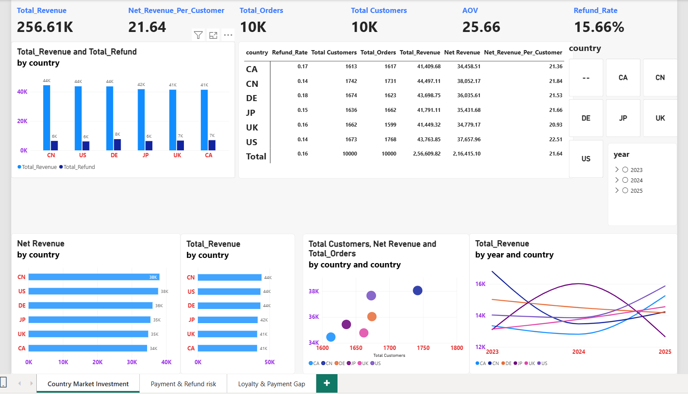
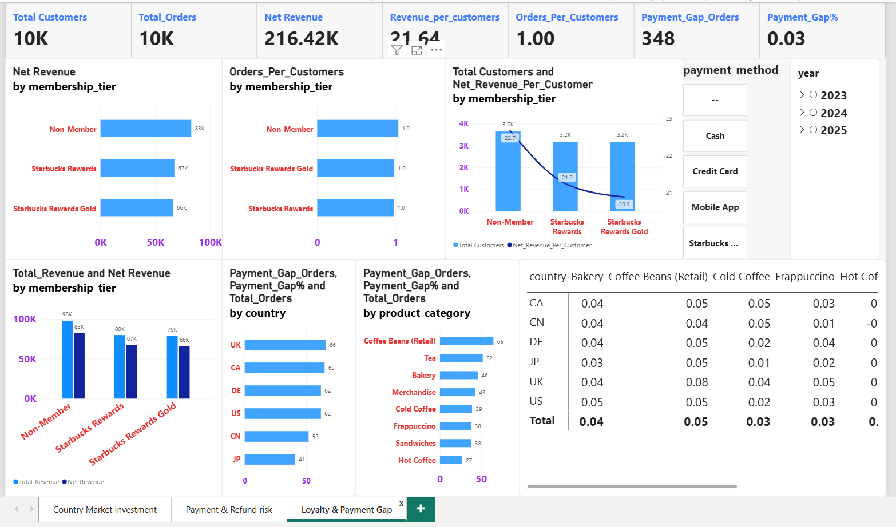
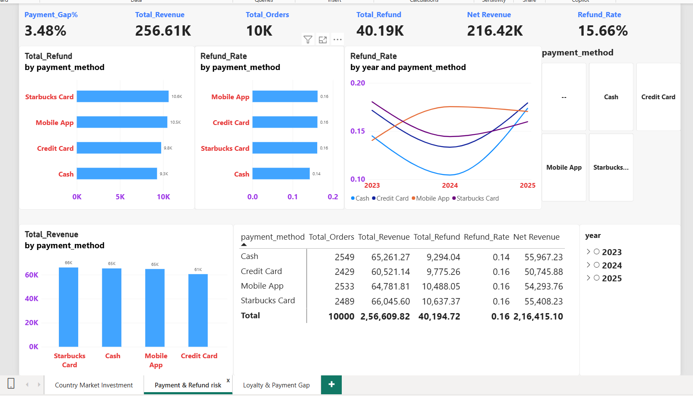

# Starbucks Sales, Refund & Loyalty Analysis | Power BI

Interactive 3-page Power BI report analysing 10,000 Starbucks orders (2023–2025) across 6 countries, 4 payment methods, 3 membership tiers and 8 product categories. It answers where revenue is made and lost, whether loyalty members are more valuable, and which payment methods carry the most refund risk.

**Tools:** Power BI Desktop · DAX · Power Query · Data Modeling

---

## Business Questions

1. Which country markets deliver the most revenue, and which lose the most to refunds?
2. Do Starbucks Rewards members generate more value than non-members?
3. Where do payment gaps occur (by country, product category)?
4. Which payment methods have the highest refund rates, and how has that changed over time?

## Dataset

- **Size:** 10,000 orders from 10,000 customers (1 order per customer)
- **Period:** 2023 – 2025
- **Dimensions:** country (CA, CN, DE, JP, UK, US), payment method (Cash, Credit Card, Mobile App, Starbucks Card), membership tier (Non-Member, Starbucks Rewards, Starbucks Rewards Gold), product category (8)
- **Source:** _add link or description here (e.g. Kaggle dataset name)_

## Dashboard Pages

### 1. Country Market Investment


Compares the six markets on revenue, refunds, net revenue, customers, orders and net revenue per customer, with country and year slicers.

### 2. Loyalty & Payment Gap


Compares membership tiers on net revenue and revenue per customer, and tracks payment gap orders by country and product category.

### 3. Payment & Refund Risk


Breaks down refunds and refund rates by payment method, including the trend across 2023–2025.

---

## Headline KPIs

| Metric | Value |
|---|---|
| Total Revenue | 256.61K |
| Total Refunds | 40.19K |
| Net Revenue | 216.42K |
| Refund Rate | 15.66% |
| Average Order Value (AOV) | 25.66 |
| Net Revenue per Customer | 21.64 |
| Payment Gap Orders | 348 (3.48% of orders) |

## Key Insights

**Country markets**
- China leads on gross revenue (44.5K) and the US is close behind (43.8K), but the US earns the highest net revenue per customer (22.51) and, along with China, has the lowest refund rate (14%).
- Germany has the highest refund rate (18%). Its gross revenue is almost level with the US, but net revenue is about 1.6K lower (36.0K vs 37.7K).
- Gross revenue across countries is fairly close (41.4K–44.5K, a gap of roughly 7%). Refunds widen the net revenue gap to about 10%, so refund control matters more than sales volume for ranking markets.
- Canada has the lowest net revenue (34.5K) and a 17% refund rate. The UK has the lowest net revenue per customer (20.93).

**Loyalty**
- Non-members contribute the most net revenue (83K vs 67K for Rewards and 66K for Rewards Gold) and also have the most customers (about 3.7K vs 3.2K each).
- Non-members also have the highest net revenue per customer (22.7 vs 21.2 and 20.9), so in this dataset loyalty tiers do not translate into higher value per customer.
- Orders per customer is 1.0 in every tier, so repeat-purchase behaviour (the main benefit of loyalty programs) cannot be measured from this data.

**Payment gap**
- 348 orders (3.48%) have a payment gap. The UK (66) and Canada (65) have the most; Japan has the fewest (41).
- By category, Coffee Beans (Retail) has the most gap orders (65), followed by Tea (52). Hot Coffee has the fewest (27).

**Payment methods and refunds**
- Cash has the lowest refund rate (14%) against 16% for Credit Card, Mobile App and Starbucks Card.
- Starbucks Card has the highest refund value (10.6K) and Cash the lowest (9.3K).
- Credit Card has the lowest revenue (60.5K) and the lowest net revenue (50.7K) of the four methods.
- Refund rates dipped in 2024 and rose again in 2025 for most methods. Cash shows the steepest rebound, from roughly 11% to about 18%.

## Recommendations

- Investigate the cause of Germany's and Canada's higher refund rates (product quality, delivery, policy) since they erase much of the gross revenue advantage.
- Review the value of the loyalty tiers: if members are not spending more, the benefits may need redesigning.
- Look at why retail coffee beans and tea have the most payment gaps and whether the checkout flow for those items can be fixed.
- Monitor Cash refund rates in 2025, since the rate is rising fastest even though Cash is still among the lowest overall.

## Data Model & DAX

_Replace this section with your actual model and measures._

- **Model:** _describe your tables and relationships, e.g. fact table (orders) linked to a date table and dimension tables_
- **Sample measures** (consistent with the figures in the report):

```DAX
Net Revenue = [Total_Revenue] - [Total_Refund]

Refund_Rate = DIVIDE ( [Total_Refund], [Total_Revenue] )

AOV = DIVIDE ( [Total_Revenue], [Total_Orders] )

Net_Revenue_Per_Customer = DIVIDE ( [Net Revenue], [Total Customers] )
```

## Features Used

- Multi-page report with consistent KPI cards on every page
- Slicers for country, year and payment method
- Bar, clustered column, line, scatter and matrix visuals
- Combo chart (customers vs net revenue per customer by membership tier)

## How to Open

1. Download `starbucks.pbix` from this repository.
2. Open it with [Power BI Desktop](https://powerbi.microsoft.com/desktop/) (free).

## Repository Structure

```
├── README.md
├── starbucks.pbix
├── 01-country-market-investment.png
├── 02-loyalty-payment-gap.png
└── 03-payment-refund-risk.png
```

## Author

**Sandeep Gollar**
[LinkedIn](https://linkedin.com/in/sandeep-yadav-21161a379) · [GitHub](https://github.com/sandeepyadav456)
